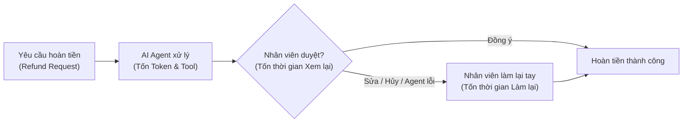
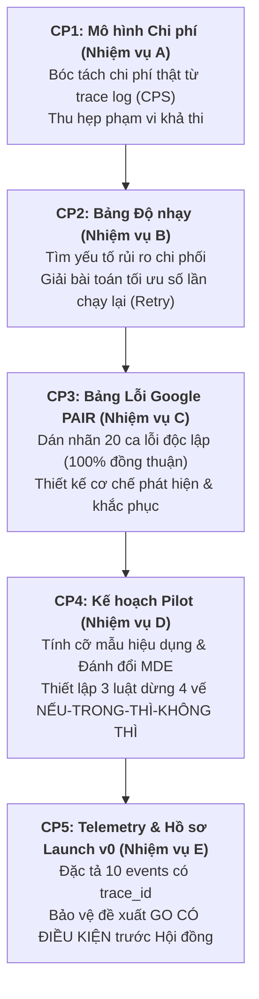

# Giải Thích Đề Bài & Tổng Kết Kết Quả Qua Các Checkpoint (CP1 – CP5)
> **Dự án:** Trợ lý AI Hoàn phí Tự động — Công ty Giao vận LogiX-VN  
> **Nhóm thực hiện:** 3ConChatLGPT (Lớp K5-L3A)  
> **Cột mốc:** Thẩm định kinh tế & Kế hoạch thử nghiệm Gate 2a  

---

## 🧭 1. Đề Bài Nói Gì? (Bối Cảnh & Bài Toán Doanh Nghiệp)

### 1.1. Bối cảnh thực tế tại LogiX-VN
LogiX-VN là một công ty giao vận logistics xử lý hàng chục nghìn đơn hàng mỗi ngày. Khi đơn hàng gặp sự cố (giao trễ, hỏng hàng, thất lạc, tính cước sai), khách hàng sẽ gửi **yêu cầu hoàn tiền (refund request)**.
- **Hiện trạng xử lý thủ công (Baseline):** 100% yêu cầu do nhân viên Chăm sóc khách hàng (CSKH) mở form tra cứu, đối soát bảng giá và bấm lệnh hoàn phí. Chi phí trung bình doanh nghiệp phải trả cho nhân viên xử lý thủ công là **12.000 đ / yêu cầu**.
- **Giải pháp AI được đề xuất:** Đưa vào một Trợ lý AI (Agent) tích hợp mô hình ngôn ngữ lớn (LLM) để đọc yêu cầu khách hàng, gọi công cụ (tools) kiểm tra dữ liệu đơn hàng và tự động tạo phiếu hoàn tiền.

### 1.2. Ảo tưởng kỹ thuật vs. Thực tế kinh tế
Nhiều kỹ sư AI thường nghĩ: *"Một lần gọi LLM chỉ tốn vài trăm đồng tiền token, rẻ hơn 12.000 đ gấp nhiều chục lần, triển khai là chắc chắn có lãi!"*  
**Nhưng thực tế thương trường không đơn giản như vậy:**
1. **Agent không hoàn hảo:** Nó có thể tính sai tiền, hiểu nhầm chính sách, hoặc gặp lỗi kết nối.
2. **Chi phí con người đồng hành (Human-in-the-loop):**
   - Khi Agent gợi ý, nhân viên phải dành thời gian **xem lại (Review)** để duyệt.
   - Khi Agent xử lý hỏng hoặc khách hàng khiếu nại, nhân viên phải tốn nhiều thời gian hơn nữa để **làm lại thủ công (Rework)**.
   - Lương nhân viên CSKH (ước tính 2.000 đ/phút) sẽ nhanh chóng "thổi bay" mọi khoản tiết kiệm từ token nếu tỷ lệ lỗi hoặc thời gian can thiệp quá cao!

### 1.3. Mục tiêu của Gate 2a là gì?
Gate 2a **không phải là buổi nghiệm thu để đưa AI vào chạy chính thức (production)**, mà là **hội đồng thẩm định kinh tế và duyệt kế hoạch chạy thử nghiệm (Pilot)**. Nhiệm vụ của nhóm là trả lời 4 câu hỏi then chốt:
1. **Có đáng chạy không?** (Mô hình kinh tế thật sự có rẻ hơn 12.000 đ không?)
2. **Nhân viên có thực sự dùng không?** (Họ có tin tưởng gợi ý của Agent hay bấm bỏ qua?)
3. **Khi hỏng thì xử lý thế nào?** (Phân loại lỗi gốc ra sao, có cơ chế bắt lỗi và dừng khẩn cấp không?)
4. **Kế hoạch thử nghiệm (Pilot) thiết kế thế nào?** (Chia nhóm đối chứng khoa học ra sao để chứng minh AI thực sự tạo ra giá trị?)

Nhóm phải đưa ra 1 trong 3 khuyến nghị: **Go** (Chạy pilot) · **Go có điều kiện** (Chỉ chạy khi thỏa mãn các ràng buộc) · **No-go** (Dừng dự án).

---

## 📊 2. Chi Tiết Từng Checkpoint: Yêu Cầu & Kết Quả Nhóm Đã Đạt Được

---

### 🔹 CP1 (Nhiệm vụ A): Mô Hình Chi Phí Mỗi Việc Thành Công (Cost-per-Success)

#### 🎯 Đề bài yêu cầu gì?
- Từ dữ liệu trace thực tế của 1.200 yêu cầu hoàn tiền (1.624 lượt chạy), xây dựng công thức tính **Chi phí cho mỗi việc thành công (CPS)**.
- So sánh CPS với hóa đơn công nghệ thuần túy (Token + Tool).
- Phân tích riêng cho từng loại yêu cầu (`noi_dia`, `hang_nang`, `quoc_te`, `doi_tac`).
- Đưa thêm chi phí hạ tầng cố định (40 triệu đ/tháng) vào bài toán để kiểm tra tính khả thi.

#### 💡 Kết quả nhóm làm ra & Ý nghĩa:
> Chi tiết số liệu tại: [`report/team/bang_chi_phi.md`](file:///d:/AI_Learning/K5-L3A-DAY13-3ConChatLGPT-LaunchEconomics/report/team/bang_chi_phi.md#L1-L51)

1. **Vượt qua 3 phép thử kiểm định toán học:**
   - Số lần chạy trung bình (tối đa 2 lần): `1,20`
   - Số lần chạy trung bình (chạy đến khi đúng): `1,25`
   - Hệ số chi phí mỗi việc thành công (tối đa 3 lần): `1,25` *(Cả 3 đều ĐẠT 100%)*
2. **Sự thật về chi phí thật (Bóc trần ảo tưởng token):**
   - Hóa đơn Token + Tool thuần túy chỉ có **275 đ / yêu cầu**.
   - Nhưng khi cộng thời gian nhân viên xem lại (1.780.000 đ) và làm lại (2.264.000 đ), tổng chi phí đội lên **4.373.585 đ [simulated]** cho 978 việc thành công.
   - **CPS thực tế = 4.472 đ [simulated]**, gấp **16,3 lần** so với hóa đơn token! Thời gian con người chiếm tới **92,5%** tổng chi phí.
3. **Phân loại đơn hàng — Cắt bỏ loại không hiệu quả:**
   - `noi_dia`: CPS = **2.696 đ [simulated]** (chỉ bằng **0,22×** so với người làm 12.000 đ) ➔ *Rất hiệu quả!*
   - `hang_nang`: CPS = **8.221 đ [simulated]** (bằng **0,69×** baseline) ➔ *Khả thi!*
   - `quoc_te`: CPS vọt lên **22.515 đ [simulated]** (gấp **1,88×** baseline, đắt gần gấp đôi người làm, tỷ lệ thành công chỉ 27,3%) ➔ **LOẠI BỎ NGAY, không cho AI làm!**
   - `doi_tac`: CPS = **10.215 đ [simulated]** (0,85× baseline, tỷ lệ thành công chỉ 54,4%) ➔ *Tạm thời loại bỏ để giảm rủi ro.*
4. **Tác động của chi phí cố định 40 triệu đ/tháng:**
   - Trong phạm vi hẹp `noi_dia` + `hang_nang` ở quy mô 45.000 YC/tháng: CPS gồm cố định là **4.599 đ [simulated] (0,38× baseline)**.
   - Nếu sản lượng giảm một nửa (16.875 việc TC/tháng): CPS tăng lên **5.784 đ [simulated] (0,48× baseline)**. Vẫn rẻ hơn 12.000 đ, dự án vẫn giữ được biên an toàn.

> [!NOTE]
> **Quyết định chốt CP1:** Thu hẹp phạm vi dự án chỉ áp dụng cho **`noi_dia` + `hang_nang`**. Dừng ngay việc áp dụng cho `quoc_te`.

---

### 🔹 CP2 (Nhiệm vụ B): Bảng Độ Nhạy & Nghịch Lý Tối Ưu Hệ Thống

#### 🎯 Đề bài yêu cầu gì?
- Kiểm tra 9 kịch bản biến động các tham số: Giá token tăng/giảm, tỷ lệ xem lại tăng/giảm, số ca làm lại tăng/giảm, lương nhân viên tăng, và giới hạn số lần chạy lại (retry).
- Tìm ra 3 yếu tố rủi ro tác động mạnh nhất đến túi tiền doanh nghiệp.
- Giải bài toán: Giới hạn retry mấy lần thì tối ưu nhất cho cả công ty?
- Đánh giá kịch bản: Nếu nhân viên bắt buộc xem lại 100% thì điều gì xảy ra?

#### 💡 Kết quả nhóm làm ra & Ý nghĩa:
> Chi tiết số liệu tại: [`report/team/bang_chi_phi.md`](file:///d:/AI_Learning/K5-L3A-DAY13-3ConChatLGPT-LaunchEconomics/report/team/bang_chi_phi.md#L52-L85)

1. **Ba yếu tố chi phối mạnh nhất:**
   - 🥇 **Hạng 1: Số ca làm lại** (Nếu số ca làm lại tăng gấp đôi ➔ CPS tăng vọt **+51,77%**, lên 6.787 đ).
   - 🥈 **Hạng 2: Tỷ lệ xem lại** (Nếu tỷ lệ xem lại gấp đôi ➔ CPS tăng **+40,70%**, lên 6.292 đ).
   - 🥉 **Hạng 3: Lương nhân viên** (Nếu lương tăng 25% ➔ CPS tăng **+23,12%**, lên 5.506 đ).
   - *Giá token chỉ là "muỗi":* Giá token tăng gấp đôi chỉ làm chi phí tăng vỏn vẹn **+5,62%**.
2. **Nghịch lý Retry (Tối ưu cục bộ vs. Tối ưu toàn cục):**
   - Nếu nhìn riêng con bot: Cho bot chạy tối đa 1 lần thì CPS của bot rẻ nhất (**4.111 đ**).
   - Nhưng khi bot dừng sau 1 lần, có tới **319 yêu cầu thất bại bị đẩy sang nhân viên CSKH làm thủ công** (mỗi ca tốn 12.000 đ).
   - Kết quả: Tổng chi phí cả công ty gánh chịu lên tới **7.449.781 đ**!
   - **Phát hiện của nhóm:** **Giới hạn 2 lần chạy** là điểm cân bằng vàng. Nó cứu được thêm 85 đơn hàng, giúp chi phí toàn công ty giảm xuống mức thấp nhất là **6.901.220 đ [simulated]** (rẻ hơn cả giới hạn 1 lần lẫn 3 lần).
3. **Cảnh báo về bẫy xem lại 100%:**
   - Nếu công ty áp dụng chính sách bảo thủ "bắt nhân viên duyệt 100% mọi đề xuất của AI", CPS sẽ vọt lên từ **11.743 đ đến 12.415 đ [simulated]** (bằng hoặc đắt hơn người tự làm 12.000 đ).
   - Khi đó, AI không những không tiết kiệm được tiền mà còn làm quy trình cồng kềnh hơn!

---

### 🔹 CP3 (Nhiệm vụ C): Bảng Lỗi Google PAIR & Kế Hoạch Khắc Phục

#### 🎯 Đề bài yêu cầu gì?
- Nhận danh sách 20 ca lỗi thực tế trong quá trình chạy thử.
- Hai thành viên phải ngồi tách biệt, dán nhãn độc lập theo 5 nhóm nguyên nhân gốc của **Google PAIR**:
  1. *Do người dùng (User error)*
  2. *Hệ thống (System error)*
  3. *Ngữ cảnh (Context error)*
  4. *Giới hạn hệ thống (System limit)*
  5. *Lỗi ngầm (Silent error)*
- Đo tỷ lệ đồng thuận (yêu cầu ≥ 80%).
- Chọn 5 ca đại diện cho 5 nhóm để lập phương án phát hiện đo lường được và phân công người chịu trách nhiệm.

#### 💡 Kết quả nhóm làm ra & Ý nghĩa:
> Chi tiết số liệu tại: [`report/team/bang_loi.md`](file:///d:/AI_Learning/K5-L3A-DAY13-3ConChatLGPT-LaunchEconomics/report/team/bang_loi.md)

1. **Đồng thuận tuyệt đối:** Hai người dán nhãn độc lập (Hoàng Anh và Hiếu) đạt tỷ lệ đồng thuận **20/20 (100%)**, vượt xa mốc 80% yêu cầu.
2. **Phân phối 20 ca lỗi:** 4 ca Do người dùng · 5 ca Hệ thống · 4 ca Ngữ cảnh · 4 ca Giới hạn hệ thống · 3 ca Lỗi ngầm.
3. **Quy tắc phân biệt then chốt:**
   - *Lỗi hệ thống vs. Lỗi ngầm:* Nếu sai sót lộ ra ngay trên màn hình hoặc nhân viên bắt được trong quy trình thường nhật ➔ **Hệ thống**. Nếu kết quả tưởng chừng vẫn đúng, khách hàng không kêu nhưng ngầm bên dưới chi phí bị đội gấp 3 lần hoặc bảng giá áp sai mà chỉ phát hiện khi kiểm toán mẫu ➔ **Lỗi ngầm**.
4. **Biện pháp khắc phục 5 ca đại diện:** Mọi biện pháp đều có event telemetry gắn `trace_id`, ngưỡng kích hoạt rõ ràng và đúng 1 người chịu trách nhiệm:
   - *Ca 9 (Người dùng nhập sai mã vận đơn):* Hệ thống tự nhận diện mã sàn TMĐT để chuyển đổi; phụ trách bởi **PM trợ lý**.
   - *Ca 7 (Lỗi hệ thống - Tiền chưa hoàn nhưng đã báo khách xong):* Đối soát mỗi giờ giữa event hoàn tiền và sổ cái ledger, ngưỡng cảnh báo 0 ca; phụ trách bởi **Kỹ sư trưởng agent**.
   - *Ca 18 (Ngữ cảnh - Khách hiểu nhầm số tiền bồi thường):* Bắt buộc mẫu tin nhắn in rõ công thức tính (VD: 30k × 50% = 15k); phụ trách bởi **Trưởng nhóm CSKH**.
   - *Ca 19 (Giới hạn - Đơn quá 12 tháng không tra được):* Gửi thông báo rõ thời hạn lưu trữ, chuyển nhân viên kèm tóm tắt; phụ trách bởi **Trưởng ca xử lý**.
   - *Ca 17 (Lỗi ngầm - Áp dụng bảng giá cũ đã hết hạn):* Tự động xóa cache khi có giá mới, đối soát kiểm toán tuần; phụ trách bởi **Kỹ sư dịch vụ bảng giá**.

---

### 🔹 CP4 (Nhiệm vụ D): Thiết Kế Kế Hoạch Pilot Khoa Học (`pilot_plan.yaml`)

#### 🎯 Đề bài yêu cầu gì?
- Thiết kế một thử nghiệm thực tế (Pilot A/B testing) chuẩn xác để chứng minh tác động của AI tách biệt với các yếu tố bên ngoài (như mùa cao điểm, thay đổi nhân sự).
- Tính toán cỡ mẫu theo thống kê (alpha = 0,05, power = 0,80, baseline 70%, kỳ vọng tăng +5 điểm phần trăm).
- Giải quyết bài toán phân bổ cụm (Cluster Randomization) và hệ số thiết kế (Design Effect - DE).
- Viết ít nhất 3 luật dừng khẩn cấp theo chuẩn 4 vế: **NẾU – TRONG – THÌ – KHÔNG THÌ**.

#### 💡 Kết quả nhóm làm ra & Ý nghĩa:
> Chi tiết số liệu tại: [`report/team/pilot_plan.yaml`](file:///d:/AI_Learning/K5-L3A-DAY13-3ConChatLGPT-LaunchEconomics/report/team/pilot_plan.yaml)

1. **Bài toán cỡ mẫu & Quyết định đánh đổi kinh tế:**
   - Do tính chất vận hành, ta không thể chia theo từng yêu cầu riêng lẻ vì nhân viên sẽ bị lẫn lộn giữa hai cách làm. Phải chia theo **nhân viên (Cluster RCT)** với tương quan nội cụm $ICC = 0,02$.
   - Khi chia theo nhân viên, công ty chỉ có **40 nhân sự** (20 can thiệp dùng AI, 20 đối chứng tự làm). Để phát hiện mức chênh lệch nhỏ +5 điểm phần trăm cần tới **84 nhân viên** ➔ **Thiếu mẫu trầm trọng!**
   - **Cách xử lý bản lĩnh của nhóm:** Thay vì "vẽ số" để qua mắt, nhóm chấp nhận đánh đổi thực tế: **Nâng MDE (Mức chênh lệch tối thiểu phát hiện được) lên 6 điểm phần trăm** (MDE = 0,06). Lúc này, với 20 người mỗi nhóm, mỗi người cần xử lý tối thiểu **m ≥ 299 yêu cầu** trong kỳ pilot (cỡ mẫu hiệu dụng đạt 859 YC, hệ số thiết kế $DE = 6,96$).
2. **Lộ trình Rollout 3 giai đoạn an toàn:**
   - Tuần 1: 10% (4 nhân viên) ➔ Tuần 2: 25% (10 nhân viên) ➔ Tuần 3+: 50% (20 nhân viên).
3. **Ba luật dừng khẩn cấp (4 vế nghiêm ngặt):**
   - 🛡️ *Luật An toàn:* NẾU tỷ lệ mở lại trong 7 ngày của nhóm dùng AI cao hơn nhóm đối chứng ≥ 2 điểm hoặc vượt 6%, hoặc có ≥ 1 ca hoàn tiền trùng TRONG 3 ngày liên tiếp THÌ Giám đốc vận hành tắt trợ lý trong 30 phút KHÔNG THÌ không được chuyển sang bước rollout tiếp.
   - 💰 *Luật Chi phí:* NẾU chi phí mỗi việc thành công > 8.000 đ TRONG 2 tuần liên tiếp THÌ PM thu hẹp về chỉ chạy đơn nội địa và giới hạn 2 lần chạy KHÔNG THÌ không được mở rộng cho hàng nặng.
   - 👥 *Luật Sử dụng:* NẾU tỷ lệ nhân viên bỏ qua gợi ý > 40% TRONG 1 tuần THÌ Trưởng nhóm CSKH phỏng vấn 5 nhân viên trong 3 ngày KHÔNG THÌ không được chuyển bước rollout tiếp.
4. **Cơ chế Rollback:** Giám đốc vận hành gạt cờ tắt hệ thống trong **30 phút**, toàn bộ luồng tự động quay về quy trình nhân viên xử lý tay, không làm gián đoạn trải nghiệm của khách hàng.

---

### 🔹 CP5 (Nhiệm vụ E): Đo Lường Telemetry, Quản Trị Rủi Ro & Hồ Sơ Launch v0

#### 🎯 Đề bài yêu cầu gì?
- Xây dựng hệ thống đo lường: Chỉ số chính (North Star), chỉ số sử dụng, chỉ số an toàn.
- Thiết kế danh mục các sự kiện (telemetry events) để kỹ thuật gắn vào mã nguồn, đảm bảo mọi sự kiện đều liên kết bằng `trace_id`.
- Nhận diện các rủi ro kinh tế lớn nhất kèm hành động xử lý.
- Đóng gói toàn bộ kết quả vào **Hồ sơ Launch v0 (1 trang)** và đưa ra đề xuất cuối cùng để bảo vệ trước Hội đồng Gate 2a.

#### 💡 Kết quả nhóm làm ra & Ý nghĩa:
> Chi tiết số liệu tại: [`report/team/chi_so.md`](file:///d:/AI_Learning/K5-L3A-DAY13-3ConChatLGPT-LaunchEconomics/report/team/chi_so.md) & [`report/team/ho_so_launch_v0.md`](file:///d:/AI_Learning/K5-L3A-DAY13-3ConChatLGPT-LaunchEconomics/report/team/ho_so_launch_v0.md)

1. **Bộ 3 chỉ số cốt lõi:**
   - *Chỉ số chính:* Tỷ lệ yêu cầu đóng trong 24h và không bị mở lại trong 7 ngày (đợt chạy thử đạt **82,83%**). Nhóm ghi nhận trung thực là số chạy thử, không tự tiện nhận vơ "AI đã làm tăng từ 70%".
   - *Chỉ số dùng:* Tỷ lệ nhân viên bỏ qua hoặc sửa gợi ý của AI (đạt **27,12%**).
   - *Chỉ số an toàn:* Tỷ lệ lỗi lọt đến khách hàng làm khách phải khiếu nại lại trong 7 ngày (đạt **4,25%** toàn bộ; **3,97%** trong phạm vi pilot).
2. **Hệ thống 10 Telemetry Events chuẩn hóa:** Đầy đủ từ `refund_request_created`, `agent_run_completed`, `agent_suggestion_shown`, đến `audit_sample_checked`, liên kết xuyên suốt qua `trace_id`.
3. **Quyết định đề xuất: GO CÓ ĐIỀU KIỆN (Conditional Go):**
   - Nhóm không chọn "Go mù quáng" (vì vẫn còn rủi ro lỗi sổ cái và cỡ mẫu), cũng không chọn "No-go" (vì tiềm năng tiết kiệm chi phí đạt tới 0,38× baseline).
   - **4 điều kiện tiên quyết bắt buộc phải xong trước khi bấm nút:**
     1. Khắc phục lỗi idempotency key và bật đối soát sổ cái chống hoàn tiền trùng (Hạn: 01/12/2026).
     2. Giám đốc vận hành ký duyệt văn bản chấp nhận mức chênh lệch phát hiện 6 điểm MDE (Hạn: 01/12/2026).
     3. Kích hoạt hạ tầng telemetry đo thời gian thực tế để thay thế hoàn toàn số giả lập `_simulated` ngay sau tuần 1 (Hạn: 08/12/2026).
     4. Ban hành lộ trình hạ tỷ lệ xem lại theo bậc (giảm dần từ 100% xuống khi tỷ lệ sửa < 15%) để tránh bẫy chi phí (Hạn: 15/12/2026).

---

## 📑 3. Bảng Tổng Hợp Đối Chiếu Qua 5 Checkpoint

| Checkpoint | Đề bài yêu cầu | Kết quả & Bằng chứng của nhóm | Kết luận kinh tế / Quyết định kỹ thuật |
| :--- | :--- | :--- | :--- |
| **CP1** *(Nhiệm vụ A)* | Tính chi phí mỗi việc thành công (CPS); so sánh với hóa đơn token; phân tách 4 loại đơn. | • CPS = **4.472 đ [simulated]** (gấp **16,3×** token) • Nhân viên chiếm 92,5% chi phí • `noi_dia` = 0,22×, `hang_nang` = 0,69× • `quoc_te` = 1,88×, `doi_tac` = 0,85× | ✂️ **Cắt bỏ hoàn toàn loại đơn `quoc_te`**; chỉ giữ lại `noi_dia` và `hang_nang` để đảm bảo chắc chắn có lãi. |
| **CP2** *(Nhiệm vụ B)* | Bảng độ nhạy 9 kịch bản; tìm 3 yếu tố nhạy nhất; tối ưu số lần chạy lại (retry); rủi ro xem lại 100%. | • Top 3 rủi ro: Làm lại (+51,8%), Xem lại (+40,7%), Lương (+23,1%) • Retry 2 lần rẻ nhất toàn công ty: **6,90 triệu đ** • Xem lại 100% đẩy CPS lên **11.743 – 12.415 đ** | 🔄 **Cài đặt bot retry tối đa 2 lần** (tránh tối ưu cục bộ 1 lần làm hại công ty); cấm áp dụng quy trình duyệt 100% kéo dài. |
| **CP3** *(Nhiệm vụ C)* | Dán nhãn 20 ca lỗi độc lập theo Google PAIR (đồng thuận ≥ 80%); lập bảng khắc phục 5 ca. | • Đồng thuận độc lập **20/20 (100%)** • Phân loại đủ 5 nhóm lỗi • 5 ca khắc phục đều có event đo được, ngưỡng cụ thể và 1 vai trò phụ trách | 🎯 **Gắn chặt sửa lỗi với trách nhiệm cá nhân** (PM, Lead Agent, CSKH) và đối soát tự động qua `trace_id`. |
| **CP4** *(Nhiệm vụ D)* | Thiết kế kế hoạch pilot khoa học; tính cỡ mẫu theo cụm; đặt 3 luật dừng NẾU-TRONG-THÌ-KHÔNG THÌ. | • Chỉ có 40 nhân sự ➔ chấp nhận MDE = 0,06 • Mỗi người xử lý $m \ge 299$ đơn, DE = 6,96 • Đủ 3 luật dừng 4 vế và rollback 30 phút | 🧪 **Chấp nhận đánh đổi thống kê minh bạch** để pilot có tính khả thi; kiểm soát rủi ro bằng luật dừng tự động. |
| **CP5** *(Nhiệm vụ E)* | Đặc tả hệ thống chỉ số & 10 events; lập Hồ sơ Launch v0 một trang; đề xuất Gate 2a. | • 3 chỉ số chuẩn + 10 events có `trace_id` • 3 rủi ro kinh tế lớn có phương án xử lý • Hồ sơ launch v0 đầy đủ 7 mục minh bạch | 🚀 **Đề xuất: GO CÓ ĐIỀU KIỆN** kèm 4 điều kiện tiên quyết nghiêm ngặt trước ngày bấm nút. |

---

## 💡 4. Ba Bài Học Xương Máu Rút Ra Từ Dự Án

> [!TIP]
> 1. **"Token rẻ không có nghĩa là AI rẻ":**  
> Chi phí công nghệ thuần túy (token/tool) thường chỉ là phần nổi của tảng băng chìm (trong bài này chỉ chiếm 7,5%). Phần chìm khổng lồ chiếm tới 92,5% chính là **chi phí thời gian của con người** khi phải giám sát, kiểm tra và sửa sai cho AI.
>
> 2. **"Tối ưu cục bộ có thể phá hủy tối ưu toàn cục":**  
> Nếu kỹ sư AI chỉ chăm chăm tối ưu cho con bot của mình (giới hạn retry 1 lần để bot có chỉ số CPS đẹp nhất: 4.111 đ), công ty sẽ phải gánh chịu thiệt hại lớn hơn nhiều (7,45 triệu đ) vì lượng rác thải dồn sang cho nhân viên giải quyết thủ công.
>
> 3. **"Làm khoa học dữ liệu là trung thực với sự đánh đổi":**  
> Khi đối mặt với giới hạn mẫu (chỉ có 40 nhân viên), nhóm không làm giả số liệu để đạt mục tiêu +5 điểm một cách phi lý, mà thẳng thắn tính toán và chứng minh sự đánh đổi: nâng MDE lên 6 điểm để bảo toàn độ tin cậy thống kê (Power = 80%). Đây chính là phẩm chất cốt lõi của một Product Manager / AI Engineer chuyên nghiệp!

---
*(Tài liệu được tổng hợp và biên soạn bởi Nhóm 3ConChatLGPT — Sẵn sàng cho phiên bảo vệ Gate 2a)*
